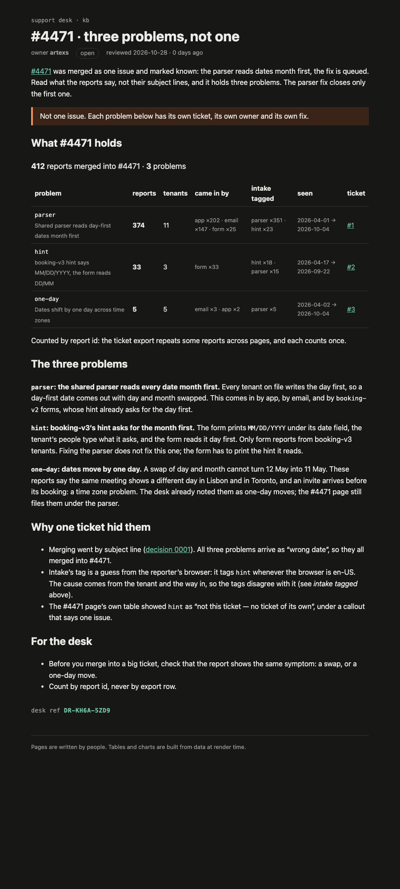

# mega-dev-s01e03 — what #4471 shows

The support desk merged 412 reports about dates into one ticket, #4471, and marked it known. It holds three problems. Each one has its own ticket in this repo's issues:

| issue | problem | reports |
|---|---|---|
| [#1](https://github.com/Artexs/mega-dev-s01e03/issues/1) | Shared parser reads day-first dates month first | 374 |
| [#2](https://github.com/Artexs/mega-dev-s01e03/issues/2) | booking-v3 form hint says MM/DD/YYYY, the form reads DD/MM | 33 |
| [#3](https://github.com/Artexs/mega-dev-s01e03/issues/3) | Dates shift by one day across time zones | 5 |

374 + 33 + 5 = 412 unique reports (the export has 427 rows; 15 are repeats).

## The kb page

- Source: [`kb/src/routes/kb/incidents/4471/problems/+page.svx`](kb/src/routes/kb/incidents/4471/problems/+page.svx)
- Logic it renders: [`kb/src/lib/kb/problems.ts`](kb/src/lib/kb/problems.ts), [`kb/src/lib/kb/ProblemTable.svelte`](kb/src/lib/kb/ProblemTable.svelte)
- As the desk sees it: [`rendered/kb/incidents/4471/problems.html`](rendered/kb/incidents/4471/problems.html) and a screenshot, [`rendered/kb-incidents-4471-problems.png`](rendered/kb-incidents-4471-problems.png)



## Build

`kb/` is the kb export (2026-10-04) plus the page above and a build setup (SvelteKit + mdsvex, static).

```
cd kb && npm ci && npm run build   # writes kb/build/
```
